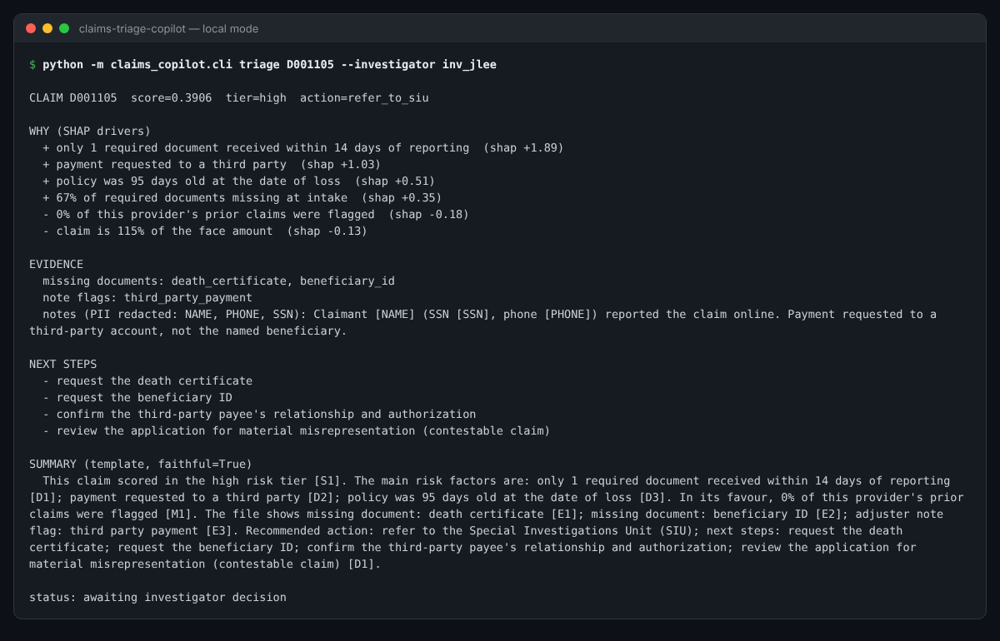
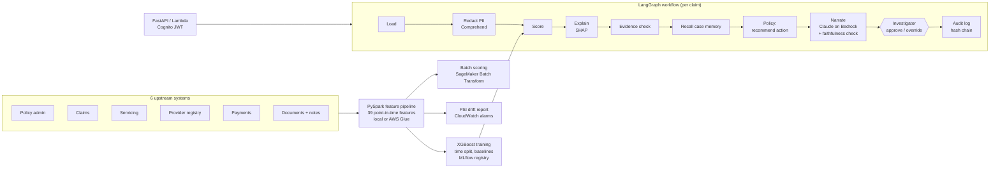

# Claims Triage Copilot

[](https://github.com/athulyakollipara-web/claims-triage-copilot/actions/workflows/ci.yml)
 

A copilot for insurance claims investigators. For each new claim it:

1. **scores fraud risk** with an XGBoost model built from six upstream systems,
2. **explains the score** with SHAP, in plain English ("beneficiary changed 41 days before the loss"),
3. **checks the file**: missing documents and red flags in the adjuster's notes, with PII redacted first,
4. **recommends an action** (fast-track, standard review, enhanced review, refer to SIU) and next steps, from a governed policy,
5. **writes a short case summary** with Claude on Bedrock. Every sentence must cite a fact from the case, or it's rejected,
6. **waits for the investigator** to approve or override, then writes both to a tamper-evident audit log.

The model ranks the work. The investigator makes the call.



## Results (2025 hold-out, trained on 2023-2024)

| | Value |
|---|---|
| XGBoost PR-AUC / ROC-AUC | **0.262** / 0.826 |
| Logistic regression baseline PR-AUC / ROC-AUC | 0.247 / 0.828 |
| Referrals needed to catch as much fraud as the legacy rules | **823** vs 3,411 for the rules |
| False-positive referrals at the rules' recall | **80% fewer** |
| Recall when reviewing the top 10% of claims | 55.7% (rules: 46.9% while flagging 24%) |
| SHAP top-driver consistency (resetting the top driver lowers the score) | 50/50 cases |
| Case summaries passing the faithfulness check | 50/50 (template narrator; run `make eval-bedrock` for a model) |

Fraud is rare (2.7% of test claims), so PR-AUC is the headline metric, not accuracy. The logistic baseline is there on purpose: XGBoost only earns its place by beating it. On a 20k-claim sample it didn't (see *Design decisions*).

These numbers come from **synthetic data** (see *Data*), so they show the method works end to end, not how a real insurer's model would perform.

## Architecture



| Piece | Tech |
|---|---|
| Feature pipeline: 6 systems → 39 features, all as of the report date (no leakage) | PySpark (local / AWS Glue) |
| Fraud model with early stopping, time-based validation, logistic + rules baselines | XGBoost, scikit-learn, MLflow |
| Reasons per claim | SHAP TreeExplainer |
| Drift monitoring | PSI per feature → CloudWatch metrics + alarms |
| PII redaction of adjuster notes | Amazon Comprehend (regex fallback locally) |
| Workflow with a human-in-the-loop pause | LangGraph (`interrupt` + checkpointer) |
| Case summaries with citation and number checks | Bedrock Converse API (Claude, Nova fallback) |
| Case memory scoped by investigator; append-only audit log | DynamoDB |
| API | FastAPI locally; Lambda + API Gateway + Cognito in AWS |
| Infrastructure | AWS CDK (Python) |

## Quickstart (local, no AWS account needed)

Requires Python 3.11+ and Java 17+ (for PySpark).

```bash
git clone https://github.com/athulyakollipara-web/claims-triage-copilot.git && cd claims-triage-copilot
make setup && source .venv/bin/activate

make pipeline    # 60k historical + 3k new claims -> features -> model -> drift report (~1 min)
make test        # 23 tests
python -m claims_copilot.cli queue
python -m claims_copilot.cli triage D001105
make serve       # http://localhost:8000/docs
```

API flow:

```bash
curl -X POST localhost:8000/claims/D001105/triage -H 'content-type: application/json' -d '{"investigator":"inv_jlee"}'
curl -X POST localhost:8000/claims/D001105/decision -H 'content-type: application/json' \
     -d '{"investigator":"inv_jlee","action":"enhanced_review","reason":"waiting on death certificate","note":"Called claimant 11/14"}'
curl localhost:8000/claims/D001105/audit
```

To use Claude for summaries: `export CLAIMS_LLM=bedrock AWS_REGION=us-east-1` (needs Bedrock model access).

## Design decisions

- **The LLM explains, it doesn't decide.** Actions come from `policy.py`: plain rules over the score and the evidence that compliance can read and sign off on. The model only writes the summary, from numbered facts it must cite. `check_faithfulness` rejects summaries with unknown citations, uncited sentences or new numbers, and the deterministic template is used instead (`test_unfaithful_llm_output_falls_back_to_template`).
- **Time-based split.** Training uses 2023-2024 claims and evaluation uses 2025, the way the model will actually be used. Features are computed as of the report date. Documents received later don't leak into the score.
- **Measure against what exists.** The business question is "same fraud caught, fewer innocent people investigated?", so the main comparison is at the legacy rules' recall. Logistic regression is the baseline model: trained on the first 20k claims only, it beat XGBoost (PR-AUC 0.230 vs 0.212). XGBoost only pulled ahead at 60k claims, when there were enough fraud cases for trees to learn interactions. Lesson: check the simple model first.
- **No `scale_pos_weight`.** It inflated scores and overfit the rare class in testing. Unweighted training plus ranking by score works better, and the scores stay usable as probabilities.
- **Stateless-safe human review.** Locally the LangGraph checkpointer pauses the graph. In Lambda, where memory doesn't survive between requests, the decision is recorded from the recommendation already in the audit log (`test_decision_survives_lost_graph_state`).
- **Audit you can trust.** Each record stores the previous record's hash, so edits break the chain (`test_tampering_breaks_audit_chain`). In AWS, the table is retained on stack deletion and the app role can only `PutItem` and `Query` on it. Identity comes from the Cognito token, not the request body.

## Deploying for a new insurer

See **[docs/DEPLOYMENT_GUIDE.md](docs/DEPLOYMENT_GUIDE.md)**: the data contract for each source system, the decisions the customer owns (review capacity, referral policy, required documents, region), a security review checklist and a shadow-mode rollout plan.

```bash
npm install -g aws-cdk && make deploy
aws s3 sync data_store s3://<ArtifactsBucket>/data_store --exclude "audit/*"
```

`deploy/sagemaker_batch.py` runs daily batch scoring with SageMaker Batch Transform. It hasn't been run in CI; see the note in the file.

## Data

No public dataset has life/disability claims with fraud outcomes *and* the documents around them, so `claims_copilot/data/generate.py` builds one. It covers six source systems, 900-series SSNs (never issued), `example.com` emails and invented names. Fraud labels come from a hidden model over known risk signals with interactions and noise. The model only sees the resulting features, never the label logic. The 2025-Q3 scoring batch is deliberately shifted (more online claims, longer reporting delays) so drift monitoring has something to find.

## Project structure

```
claims_copilot/
  data/        synthetic six-system generator
  features/    PySpark feature pipeline
  model/       training + baselines, SHAP explanations, PSI drift
  agent/       LangGraph workflow, case memory
  llm/         narrative writer + faithfulness check
  policy.py    governed triage rules
  evidence.py  document checklist + note red flags
  pii.py       Comprehend / regex redaction
  audit.py     hash-chained audit log (file / DynamoDB)
  service.py   wiring; api/ FastAPI; lambda_handler.py
eval/          end-to-end evaluation -> MLflow
infra/         CDK stack
deploy/        SageMaker batch scoring
docs/          deployment guide
```
